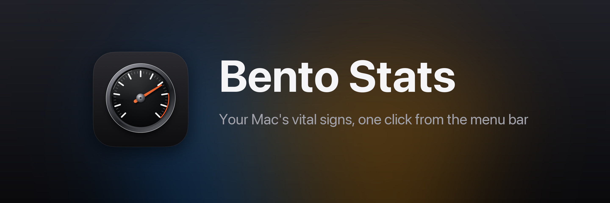
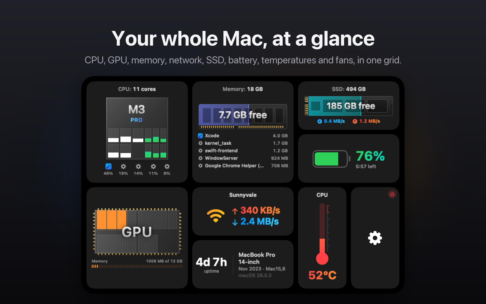
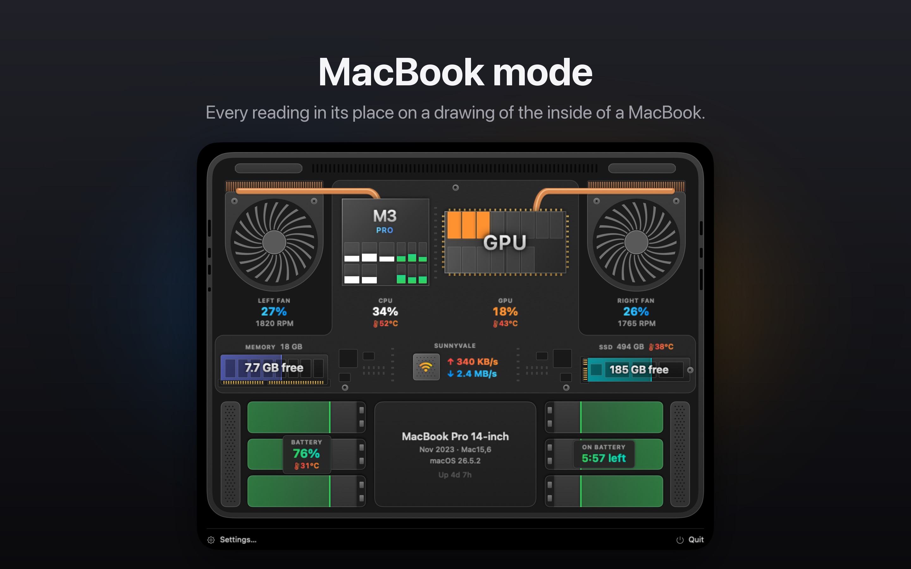
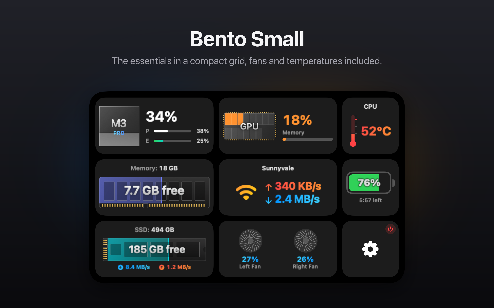
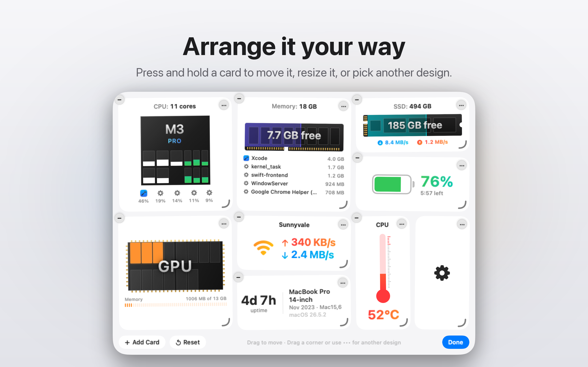
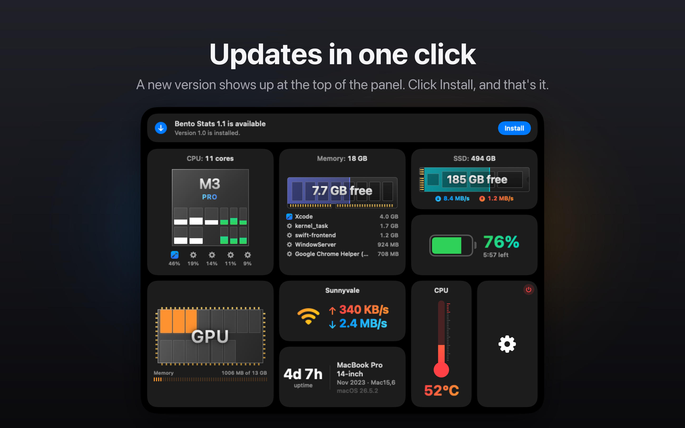

<p align="center"></p>

<p align="center">
  <a href="https://github.com/iAlborz/BentoStats/releases/latest/download/BentoStats.dmg"><b>Download Bento Stats</b></a>
  &nbsp;·&nbsp; free &nbsp;·&nbsp; macOS 14 or later &nbsp;·&nbsp; Apple silicon
</p>

Bento Stats is a system monitor for the Mac menu bar. Click it and a panel drops down with
your Mac's vital signs laid out as a bento grid of cards: how hard the CPU and GPU are
working, how much memory is free, how fast data moves over the network and to the SSD, how
the battery is doing, and how hot the Mac is running.

It is built to stay light, because a monitor runs all day. It has no Dock icon, reads the
system through Mach, IOKit, sysctl and CoreWLAN, and keeps everything on your Mac: no
accounts, no analytics, no tracking.



## What it shows

- **CPU:** the chip drawn with its performance and efficiency cores, each filling with its own load, and the apps keeping it busiest
- **GPU:** its cores lighting up as the load rises, and how much memory it is using
- **Memory:** free memory on a memory module, memory pressure, and the apps using the most
- **Network and SSD:** download, upload, read and write speeds, with their history
- **Battery:** charge and time remaining
- **Temperatures and fans:** the CPU, GPU and every other sensor, and how fast each fan is spinning
- **System:** uptime and exactly which Mac you have

Point at any card for history charts and the details the card leaves out.



## Make it yours

- Press and hold a card to rearrange the grid: drag cards around, resize them, and pick from several designs for each
- **Bento** for the full picture, **Bento Small** for a compact one, or **MacBook mode**
- Choose what the menu bar itself shows
- Get a notification when a reading crosses a limit you set
- Global keyboard shortcuts, and light and dark appearance

 

## Install

1. Download [BentoStats.dmg](https://github.com/iAlborz/BentoStats/releases/latest/download/BentoStats.dmg) from the [latest release](https://github.com/iAlborz/BentoStats/releases/latest).
2. Open it and drag Bento Stats into Applications.
3. Open Bento Stats. It lives in the menu bar, not the Dock.

It is signed with a Developer ID and notarized by Apple, so it opens without a warning.

### Updates

Bento Stats checks this repository for a new release once a day. When one is out, an
**Install** button shows up at the top of the panel, in Settings › General and on a
notification. One click downloads it, makes sure it is signed by Bento Stats' developer and
notarized by Apple, installs it and reopens the app. Turn the check off in Settings ›
General. Version 1.0 predates this, so from 1.0, download the latest release once by hand.



### This download or the Mac App Store?

Bento Stats is also coming to the Mac App Store, but macOS does not let App Store apps read
temperature sensors or fan speeds, so that version shows the Mac's thermal state (normal,
elevated, high or critical) in their place.

| | This download | Mac App Store |
|---|:---:|:---:|
| CPU, GPU, memory, network, SSD, battery | ✓ | ✓ |
| Temperatures and fan speeds | ✓ | Thermal state only |
| Updates | One click, in the app | Automatic, from the App Store |

## Privacy

Bento Stats collects nothing. Your Mac's statistics are read from macOS, shown to you and
never sent anywhere. It makes two kinds of network request, and you can turn off both: the
public IP lookup, which is off until you turn it on, and the daily update check to GitHub,
which only the download makes. [PRIVACY.md](PRIVACY.md) has the details.

## Build from source

You need macOS 14 or later and Xcode 16 or later.

```sh
git clone https://github.com/iAlborz/BentoStats.git
cd BentoStats
open "$(Scripts/build.sh release | tail -n 1)"
```

`Scripts/build.sh` builds with SwiftPM, wraps the binary in a `.app` bundle and signs it ad
hoc, which is enough for macOS to give it a menu bar item on the Mac that built it. It
prints the app's path last. With no argument it makes a debug build. A build from source
never updates itself.

Two more scripts make the copies that ship:

- `Scripts/direct.sh` makes the download: it has Xcode sign the app with the team's
  Developer ID and Apple notarize it, then writes `dist/BentoStats.dmg`, and
  `dist/BentoStats.zip` for the updater. A release carries both, under those names, on a
  tag `v<version>`.
- `Scripts/appstore.sh` archives the sandboxed Mac App Store version for Xcode's Organizer.

## Source layout

| Path | What lives there |
| --- | --- |
| `Sources/AirStatKit` | Collectors, the sampling engine, settings, formatting, the update feed and installer. No UI. |
| `Sources/AirStatUI` | Menu bar drawing, the panel and its cards, settings window, charts, design system, updater. |
| `Sources/AirStats` | The executable, app delegate, and the probe and render commands. |
| `Tests/AirStatKitTests` | Contract tests for the collectors, plus settings, layout, formatting and updates. |
| `Scripts/build.sh` | Builds the binary and assembles the `.app`. |
| `Scripts/direct.sh` | Signs, notarizes and packages the download. |
| `Scripts/appstore.sh` | Archives the Mac App Store version. |
| `Scripts/make-icon.swift` | Draws the app icon, size by size. |

The targets keep the names they had in AirStats, which nobody using the app ever sees.
`AirStatKit` never imports SwiftUI or AppKit, which is what lets the tests and the probe
run in a windowless process.

## Feedback

Bugs and ideas go on the [issue tracker](https://github.com/iAlborz/BentoStats/issues).

## Credits and license

Bento Stats is based on [AirStats](https://github.com/byrencheema/airstats) 1.5, the
open-source monitor by Byren Cheema. MIT, see [LICENSE](LICENSE).
